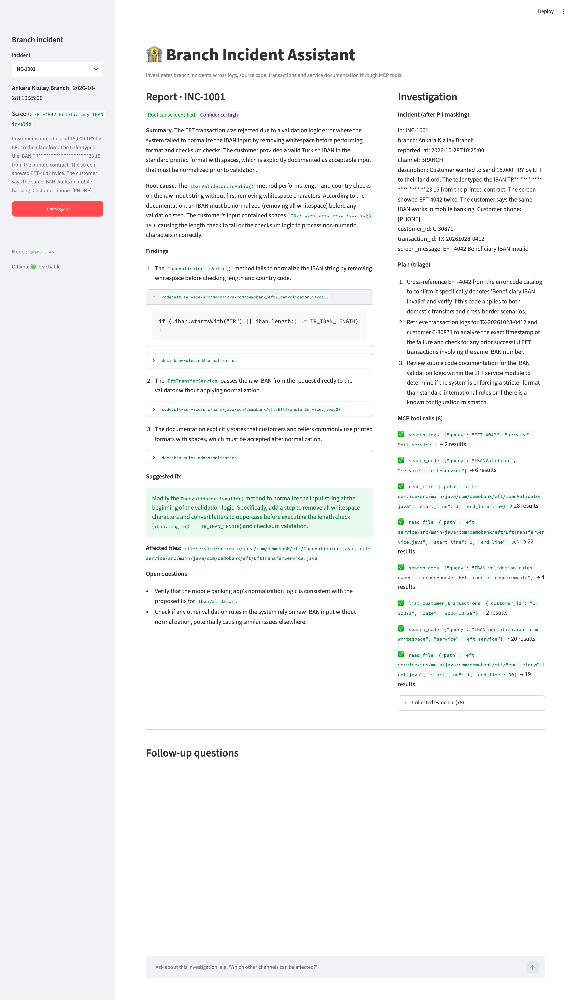
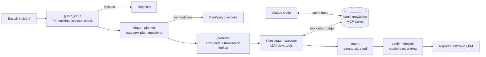
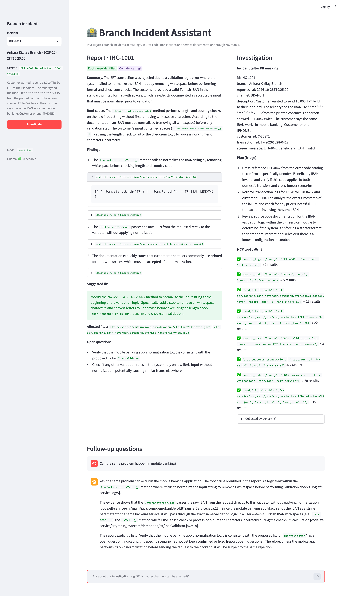
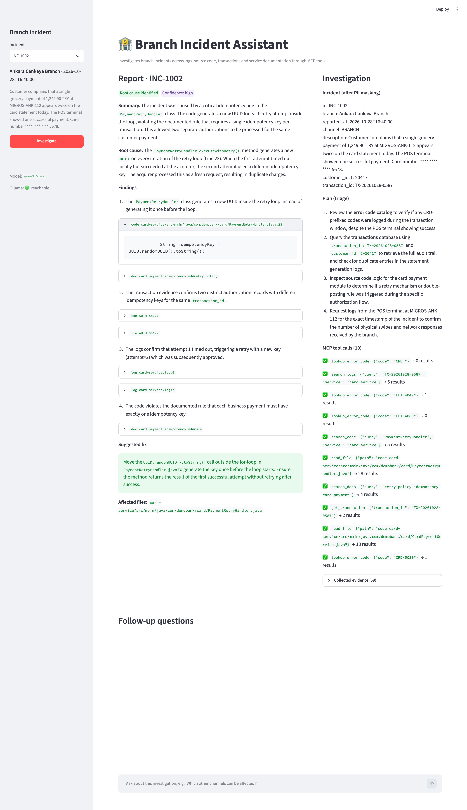
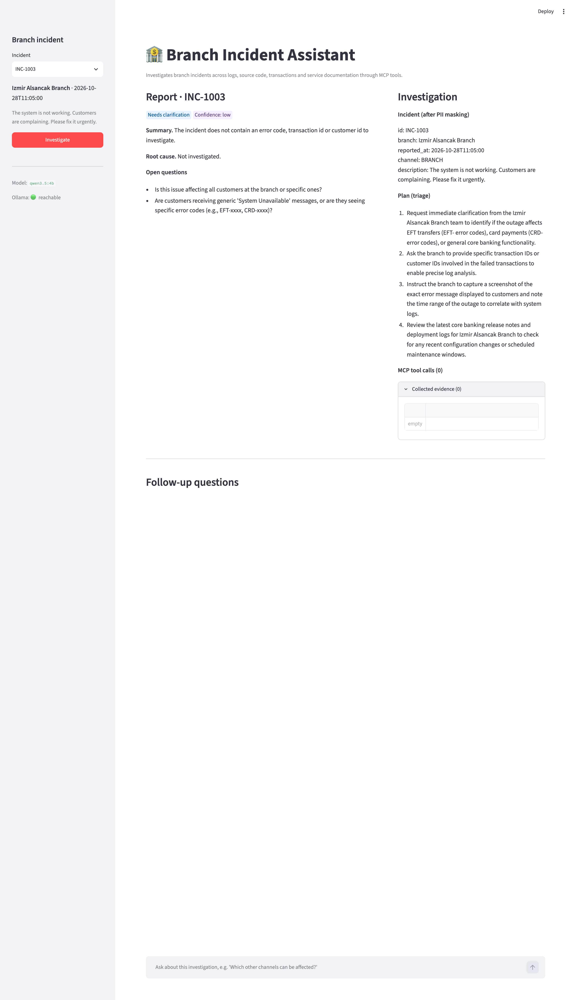
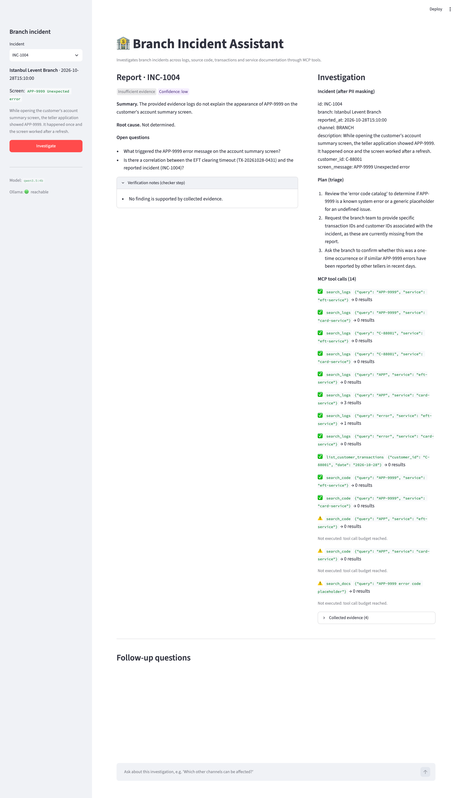

# Branch Incident Assistant

A local agentic assistant that investigates incidents reported by bank branches. It searches logs, source code, transaction records and service documentation, then produces a **root cause analysis with cited evidence and a suggested fix**. The same knowledge layer is exposed as an **MCP server**, so a coding assistant such as Claude Code uses the same tools while implementing the fix.

> All customers, transactions, logs, source code and documents in this repository are synthetic.



## Problem

When a branch reports a problem ("the customer got EFT-4042", "the card was charged twice"), a developer has to:

1. find which service and component own the error,
2. search the logs for the transaction,
3. read the code that produced the error,
4. check the business rule in the documentation,
5. check the transaction records,
6. decide whether it is a user error or a defect, and write it up.

This takes time and depends on knowing the system. Incident descriptions are often incomplete, and a wrong guess sends the fix in the wrong direction.

### Why an agent and not a single LLM call

The next step depends on what the previous step found. The error code decides which component to look at, the log line decides which file and lines to read, and the code decides which rule to check. If the incident has no identifiers the assistant must stop and ask, and if nothing is found it must say so instead of inventing a cause. A single prompt cannot collect this evidence. A fixed script cannot adapt to different incident types.

## Architecture



A single LangGraph `StateGraph` with clear roles:

| Node | Role | LLM? |
| --- | --- | --- |
| `guard_input` | Masks IBAN, card number, national id, phone and e-mail. Rejects prompt-injection patterns. | No |
| `triage` | Planner: classifies the incident and writes an investigation plan. If there is no error code, transaction id or customer id, it returns clarifying questions and stops. | Yes |
| `prefetch` | Deterministic first step: looks up the known error codes and transaction ids. | No |
| `investigate` ⇄ `tools` | Executor: the model chooses MCP tools in a loop until it can explain the cause, limited by `MAX_TOOL_CALLS`. | Yes |
| `report` | Writes a typed `InvestigationReport` (Pydantic) that may cite only evidence refs. | Yes |
| `verify` | Checker: removes citations that the tools never returned, drops unsupported findings, lowers confidence and masks PII. | No |
| `followup` | Answers follow-up questions on the same thread from the stored report and evidence (LangGraph checkpointer memory). | Yes |

**Why one agent and not several:** finding a root cause means combining log, code and documentation evidence in one line of reasoning. Splitting this across specialist agents would add routing decisions and hand-offs. With a 4B local model, every extra decision is another place to fail. Planner, executor and checker are kept as separate graph nodes instead.

### MCP server (`mcp_server/`)

| Tool | Purpose |
| --- | --- |
| `lookup_error_code` | Error catalog: owning service and component |
| `search_logs` | Keyword search in service logs, returns `log:<file>:<line>` refs |
| `search_code` | Keyword search in Java sources, returns `code:<path>:<line>` refs |
| `read_file` | Reads a line range. Limited to the source workspace (path traversal blocked) and 120 lines. |
| `search_docs` | RAG: semantic search over service docs (Chroma + Ollama embeddings), returns `doc:<file>#<section>` refs |
| `get_transaction` | Read-only, parameterized SQLite lookup |
| `list_customer_transactions` | A customer's transactions on a date (duplicate detection) |
| resource `docs://coding-standards` | Team coding standards for coding assistants |

Every tool returns `{"ok", "results": [{"ref", "text"}], "error"?}`. Errors are returned as data, so the agent can try another way instead of crashing.

### Training topics used

| Topic | Where |
| --- | --- |
| Tool calling, worker agent | `investigate` ⇄ `tools` loop with call budget |
| Planner / executor | `triage` plan → `investigate` |
| MCP | `mcp_server/server.py`, consumed by the agent (`langchain-mcp-adapters`) and by Claude Code |
| RAG, vector DB | `mcp_server/retrieval.py`, `ingest.py` |
| Memory | `InMemorySaver` checkpointer, follow-up questions per thread |
| Guardrails, human in the loop | `guards.py`. The fix is only a suggestion: a developer applies it, and Claude Code asks before editing. |
| Prompt engineering | `prompts.py`: role / task / context / constraints templates, refs required |
| Self-check / verify | Deterministic `verify_citations` |
| Error handling | Tool errors as data, tool budget, structured output retry, clarification and insufficient-evidence paths |

## Technologies

| Technology | Why |
| --- | --- |
| Python 3.13 | Same language as the training examples |
| LangGraph 1.2 | Explicit state graph, conditional routing, checkpointer memory |
| Ollama + `qwen3.5:4b` | Local model with tool calling. No API key, and no data leaves the machine. |
| `qwen3-embedding:0.6b` + Chroma | Local embeddings and a persistent vector store for documentation RAG |
| MCP Python SDK (`FastMCP`) + `langchain-mcp-adapters` | One tool layer shared by the agent and coding assistants |
| SQLite | Zero-setup read-only transaction store |
| Pydantic | Typed triage and report outputs |
| Streamlit | Simple UI for the demo |

## Setup

Requirements: Python 3.13 and [Ollama](https://ollama.com).

```bash
ollama pull qwen3.5:4b
ollama pull qwen3-embedding:0.6b

python3.13 -m venv .venv
source .venv/bin/activate
pip install -r requirements.txt
cp .env.example .env          # optional, defaults work with a local Ollama

python ingest.py              # creates runtime/transactions.db and the Chroma index
```

## Run

```bash
streamlit run app.py          # http://localhost:8501
```

Select an incident and press **Investigate**. A run takes about 30-80 seconds on a laptop (Apple Silicon, local 4B model).

CLI:

```bash
python cli.py INC-1001
python cli.py INC-1001 --ask "Can the same problem happen in mobile banking?"
python cli.py --all           # runs all incidents, writes runtime/evaluation.json
```

Tests (no Ollama needed):

```bash
pytest
```

### Use the MCP server from Claude Code

`.mcp.json` registers the server for this project. Start `claude` in the repository root, approve the `bank-knowledge` server, and ask for example:

> Investigate INC-1001 with the bank-knowledge tools and implement the fix following docs://coding-standards.

See [docs/claude-code-mcp-demo.md](docs/claude-code-mcp-demo.md) for a recorded run, where Claude Code found the defect and proposed a diff and a JUnit test using only the MCP tools.

## Demo incidents

| Incident | Report | Expected behaviour | Result |
| --- | --- | --- | --- |
| INC-1001 | EFT-4042 when the teller types the IBAN with spaces | `IbanValidator` checks length and checksum without the normalization the IBAN rules require → root cause in code, fix suggested | ✅ root_cause_identified |
| INC-1002 | Card charged twice | `PaymentRetryHandler` creates a new idempotency key per retry. Two approved authorizations in the transaction table. | ✅ root_cause_identified |
| INC-1003 | "The system is not working" | No identifiers → asks clarifying questions, no investigation | ✅ needs_clarification |
| INC-1004 | Unknown APP-9999 | Not in catalog, logs or code → says so, no invented cause | ✅ insufficient_evidence |

The results come from live runs on 2026-10-29 with `qwen3.5:4b`. Small local models are not deterministic: report wording and the tool path change between runs, and an earlier run of INC-1001 blamed the user input before the prompts were tightened. The `verify` step makes sure every remaining citation points to real evidence. It cannot guarantee that the reasoning is correct.

## Screenshots

| | |
| --- | --- |
| INC-1001 report with evidence |  |
| Follow-up question (memory) |  |
| INC-1002 duplicate charge |  |
| INC-1003 clarification |  |
| INC-1004 insufficient evidence |  |

## Project structure

```
app.py                     Streamlit UI
cli.py                     Command line runner
ingest.py                  Builds SQLite DB and vector index
incident_assistant/
  graph.py                 LangGraph workflow
  prompts.py               Prompt templates
  guards.py                PII masking, injection check, citation verification
  models.py                Pydantic models
  mcp_client.py            MCP stdio client
  config.py                Settings from .env
mcp_server/
  server.py                MCP tools and resource
  repository.py            Logs, code, catalog, transactions
  retrieval.py             Documentation RAG
data/                      Synthetic incidents, logs, docs, seed SQL
  workspace/               Java sources of the investigated services (reference code, not built or run)
tests/                     Unit and routing tests (no model needed)
```

## Limitations and future work

- Synthetic data, a single local 4B model and in-memory conversation memory. Threads are lost on restart.
- Keyword log and code search. Large codebases would need code indexing.
- The agent suggests fixes but does not apply them. Applying a fix with human approval happens in the coding assistant.
- Possible next steps: persistent checkpointer (SQLite), evaluation set with expected results, Jira integration, a larger model for report writing.
